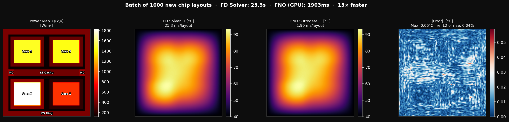

# Chip Thermal — neural surrogates for steady-state chip temperature



Predict the steady-state temperature of a chip from its power-density map:

```
-∇²T = Q(x, y)    on [0, 1]²
T = 40 °C         on the boundary (isothermal package)
```

Ground truth comes from a sparse finite-difference solve (`solver.py`, scipy
LU). Three surrogates are trained on 1 000 solved layouts and evaluated on
1 000 new ones:

| Variant (`--model`) | What it is |
|---|---|
| `fno` | plain Fourier Neural Operator |
| `constrained` | `ConstrainedFNO(constraint="dirichlet")`: the 40 °C package boundary holds **exactly**, for any weights |
| `residual` | `NeuralResidualCorrector`: a coarse FD solve on a 4× coarser grid does the bulk of the physics; the network learns only its error |

## Results

| Model | Error on the rise (mean / worst) | Worst error | Boundary deviation | Time per layout | vs FD solver |
|---|---|---|---|---|---|
| FNO | 0.074% / 0.76% | 0.55 °C | 0.41 °C | 1.6 ms | 16× faster |
| Constrained FNO (exact 40 °C boundary) | 0.074% / 0.74% | 0.57 °C | **0 (exact)** | 1.4 ms | 18× faster |
| Residual corrector (coarse FD + FNO) | 0.012% / 0.07% | 0.08 °C | 0.08 °C | 2.7 ms | 9× faster |

FD solver: 25.4 ms per layout (scipy sparse LU, CPU). Models: batched on an AMD Radeon RX 9070 XT (ROCm 7.2, WSL2), including host↔device copies. All models: width 64, 4 layers, 16 modes, 200 epochs, `norm=None`.

**Calibrated error bars (FNO):** calibrated on 500 fresh layouts, the conformal intervals are ±0.14 °C and contained the true temperature at every pixel for 88.9 % of 1 000 further layouts (target 90 %; a single run is expected to land within about ±1.6 points of 90.2 % — the average is verified by a 400-run statistical test).

## Dataset

| Property | Value |
|---|---|
| Source | scipy sparse FD (5-point Laplacian, direct LU) |
| Resolution | 128 × 128 |
| Samples | 1 000 train + 200 validation (+ fresh layouts for evaluation) |
| Temperature range | 40–93 °C |
| Floorplan | 4 compute cores with L2 shells, L3 cache band, 2 memory controllers, I/O ring — each with random utilisation |

The dataset file is named after its settings (`data/chip_thermal_<n_train>_<n_val>_<H>x<W>_seed0.npz`),
so changing `--resolution` or `--n_train` never silently reuses stale data.

## Quickstart

```bash
cd projects/chip_thermal

python train.py --device cuda                      # FNO
python train.py --device cuda --model constrained  # exact boundary condition
python train.py --device cuda --model residual     # coarse solver + correction

python compare.py --device cuda                    # speed + accuracy on 1 000 new layouts
python calibrate.py --device cuda --model fno      # conformal error bars

# all three models side by side
python ../../benchmarks/chip_thermal.py --checkpoint_dir checkpoints
```

CPU smoke test: `python train.py --device cpu --n_train 200 --epochs 20 --resolution 64`.

## Uncertainty (conformal prediction)

`calibrate.py` wraps a trained model in `ConformalNeuralOperator`, calibrates
it on freshly generated random layouts and checks coverage on a further set of
new layouts. The guarantee: for a new layout from the same distribution, the
true temperature lies inside `[prediction ± q̂]` at **every pixel** with
probability ≥ 1 − α.

Measured with the FNO: calibration on 500 random layouts gives q̂ = 0.14 °C; coverage on 1 000 further layouts is 88.9 % (target 90 %, within normal run-to-run spread).

## Training options

| Flag | Default | Notes |
|---|---|---|
| `--model` | `fno` | `fno` / `constrained` / `residual` |
| `--norm` | `none` | normalisation inside Fourier blocks (`none` = reference FNO, `instance` = legacy) |
| `--epochs` | 200 | cosine schedule with warm-up over this many epochs |
| `--patience` | 0 (off) | early stopping; off by default because it would cut the cosine schedule short — the best checkpoint is kept either way |
| `--hidden`, `--n_layers`, `--modes` | 64, 4, 16 | FNO width, depth, Fourier modes |
| `--resolution`, `--n_train`, `--n_val` | 128, 1000, 200 | dataset |
| `--data` | auto | dataset file to use/create |
| `--curriculum` | off | start with 4 Fourier modes, unlock 4 more every 30 epochs |
| `--mode_sweep` | off | short trainings at several mode counts; train with the smallest within 2 % of the best |
| `--tune`, `--tune_trials` | off, 20 | Optuna search with Hyperband pruning (trial checkpoints go to `checkpoints/tuning/`) |
| `--grad_ckpt` | off | gradient checkpointing (less GPU memory) |
